# 关于 Cangjie Core Team 成员

<table>
<tr>
<td width="170" align="center" valign="top">
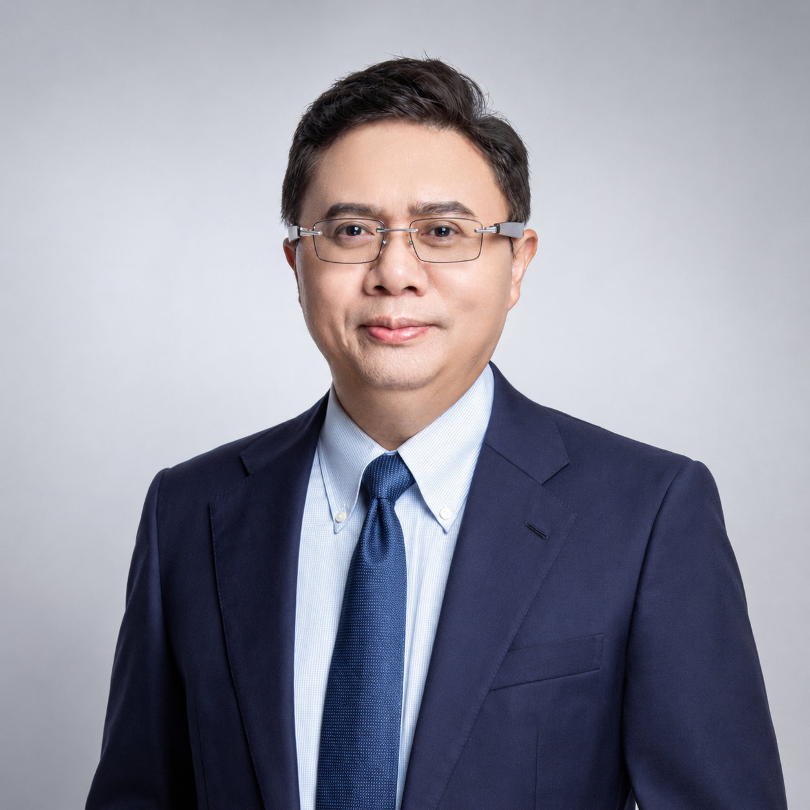
 
<strong>龚体</strong>
 
<strong>主席</strong>
</td>
<td valign="top">
华为终端BG软件部总裁、OpenHarmony项目群工作委员会主席。
长期负责鸿蒙操作系统研发、系统体验迭代与生态建设，主导OpenHarmony社区治理和行业化推广，推动开源鸿蒙在医疗、工业、交通等多领域落地。积极推进鸿蒙人才培养，推动高校鸿蒙课程体系落地、培育鸿蒙开发者后备力量。
</td>
</tr>
</table>

<table>
<tr>
<td width="170" align="center" valign="top">
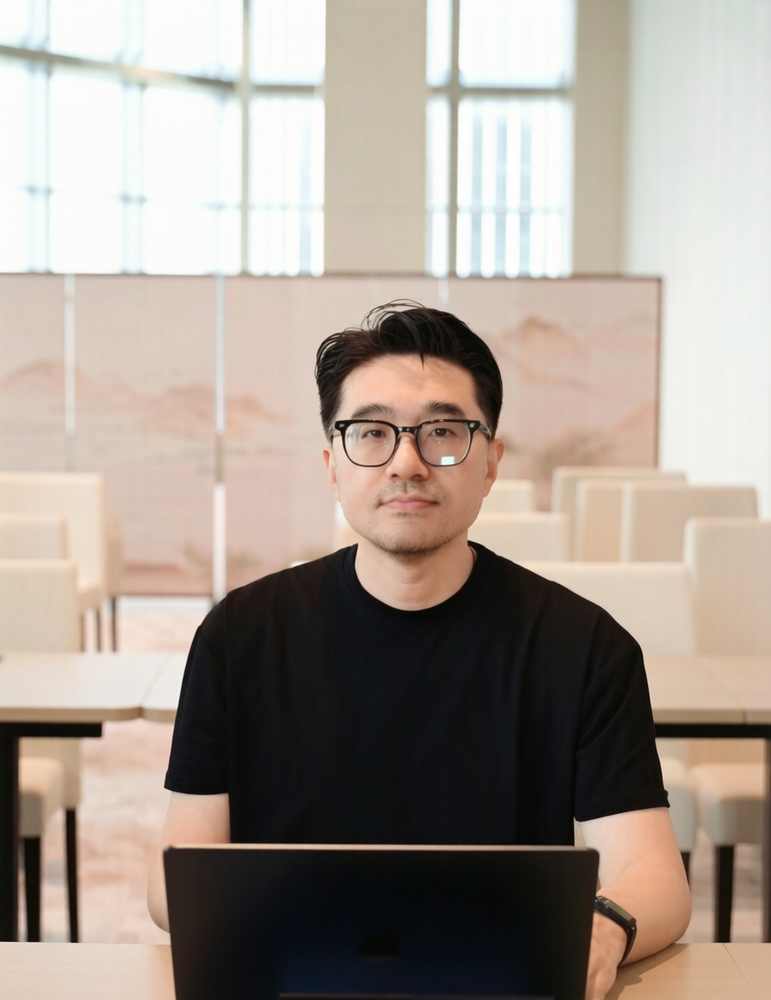
 
<strong>董鑫</strong>
 
<strong>执行主席</strong>
</td>
<td valign="top">
2008-2017就职于微软海外欧洲研发中心，任技术专家，参与Microsoft Azure、Dynamics 365基础设施架构与技术管理工作。2017年回国加入华为， 先后从事华为云平台、昇腾AI芯片软件栈研发工作，担任高级技术专家，首席规划等角色。2022年起负责20212基础软件院编程语言与IDE业务项目群管理工作，与团队一起先后完成仓颉语言的发布、开源、开放及生态拓展等工作，并于2025年初开始推动团队AI先驱研发变革，取得卓越成效。
</td>
</tr>
</table>

<table>
<tr>
<td width="170" align="center" valign="top">
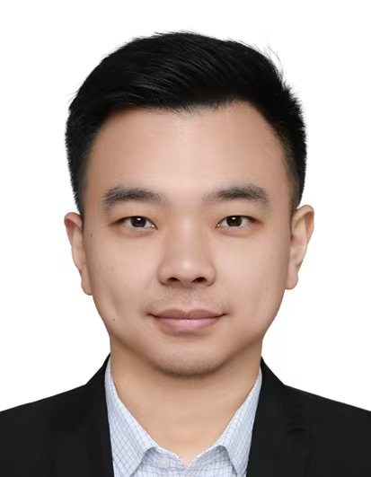
 
<strong>陈平</strong>
 
<strong>成员</strong>
</td>
<td valign="top">
工业和信息化部电子第五研究所软件与系统研究院科研创新部主任，中央网信优秀人才、中国计算机学会开源发展委员会执行委员、中国电子学会可靠性分会委员，长期从事软件领域技术研究、战略规划和标准研制工作。近年来，围绕工业软件工程化和应用技术、智能技术赋能软件工程与质量可靠性、软件中试和仿真标定、开源三方组件安全性和可信溯源等领域，主持国家级、省部级项目40余项，发表高质量论文17篇，专著2本，获得国家和省部级荣誉3项，主持开发多款工具产品，获得8项发明专利和9项著作权。
</td>
</tr>
</table>

<table>
<tr>
<td width="170" align="center" valign="top">
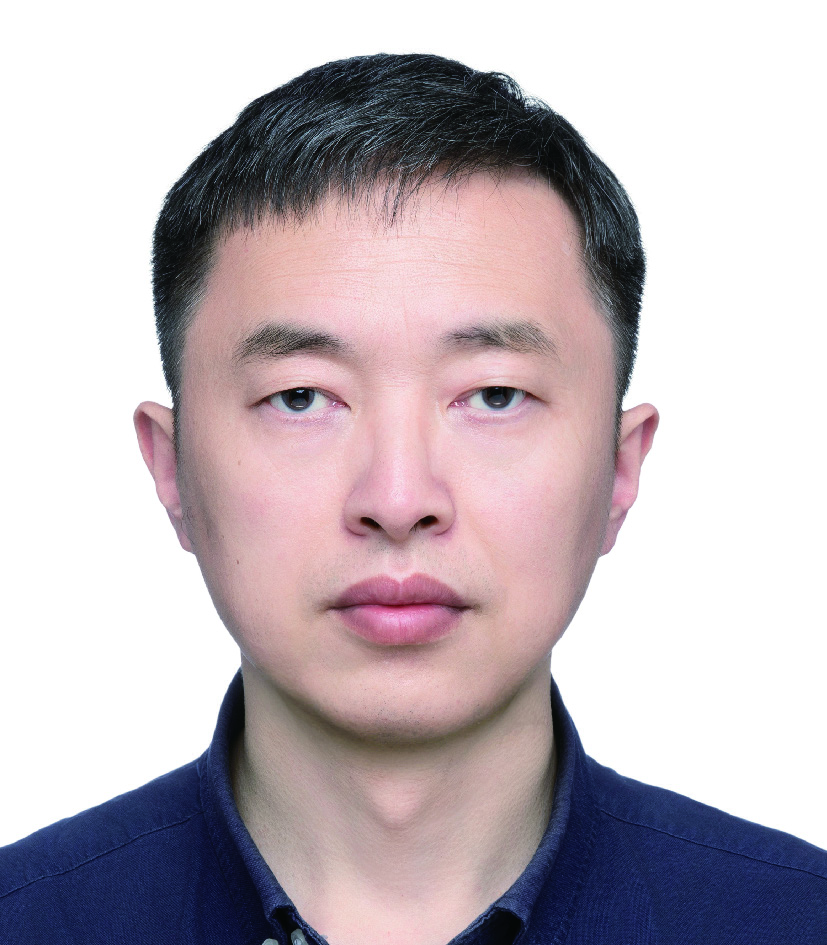
 
<strong>冯新宇</strong>
 
<strong>成员</strong>
</td>
<td valign="top">
华为编程语言首席专家，仓颉编程语言首席架构师，南京大学教授；主要研究方向为程序设计语言理论和形式化程序验证。主要工作包括仓颉编程语言、安全系统编程语言、操作系统内核验证、编译器验证、以及细粒度并发算法验证等。
</td>
</tr>
</table>

<table>
<tr>
<td width="170" align="center" valign="top">
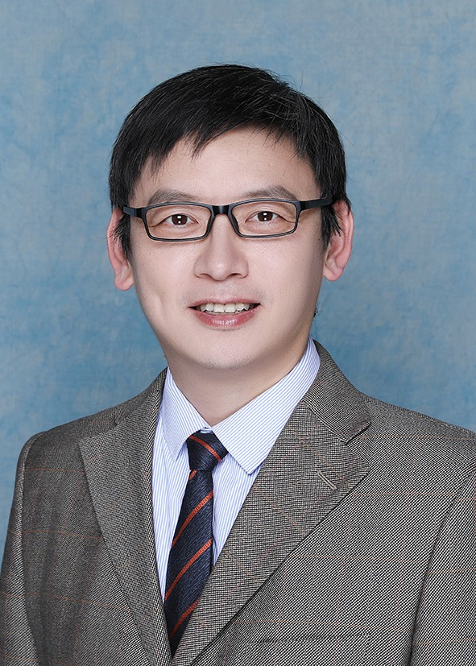
 
<strong>胡春明</strong>
 
<strong>成员</strong>
</td>
<td valign="top">
北航软件学院教授，院长，国家级领军人才。复杂关键软件环境全国重点实验室副主任，openEuler学术与教育委员会主任，中国计算机学会系统软件专委会副主任，主讲编译技术、云计算技术原理等课程。主要研究方向为计算机软件与理论、分布式系统、计算系统虚拟化、数据中心资源管理与调度、图计算查询优化等。已主持国家级项目（及课题）8项，主持北京市重点项目3项，获得授权技术发明专利50余项。
</td>
</tr>
</table>

<table>
<tr>
<td width="170" align="center" valign="top">
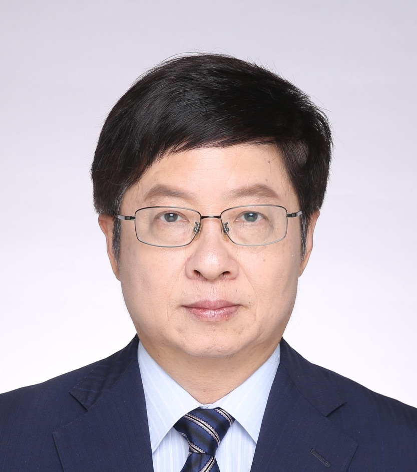
 
<strong>胡振江</strong>
 
<strong>成员</strong>
</td>
<td valign="top">
北京大学讲席教授、计算机学院院长。1996 年获日本东京大学博士学位，曾任东京大学信息理工学研究科教授、日本国立信息学研究所教授/系主任。长期从事程序设计语言与软件工程的研究，曾获日本软件科学会基础研究成就奖、日本科学技术振兴机构“21 世纪先驱科学家”称号。日本工学会会士、日本工程院外籍院士、欧洲科学院外籍院士、IEEE 会士。
</td>
</tr>
</table>

<table>
<tr>
<td width="170" align="center" valign="top">
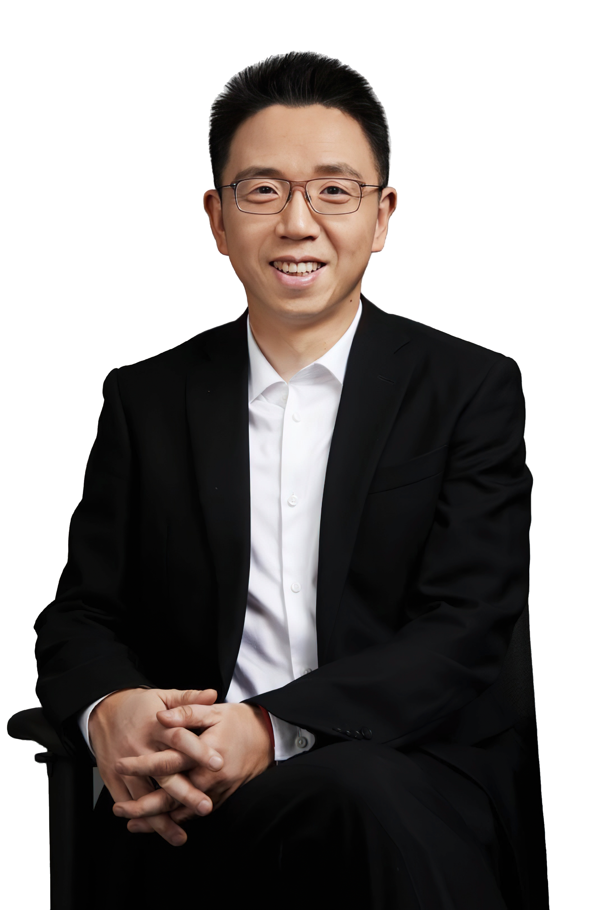
 
<strong>蒋涛</strong>
 
<strong>成员</strong>
</td>
<td valign="top">
中国专业开发者社区CSDN的创始人兼董事长。在长达 30 余年的职业生涯中，他将软件、互联网和创业领域的专业知识融会贯通。他曾领导过巨人手写电脑、金山词霸和豪杰超级解霸等项目。除创办 CSDN 外，蒋涛先生还创办了《程序员》杂志、博文视点和传智播客。同时，作为创业投资人已战略性投资了80多家高科技创业公司。蒋涛先生现任开放原子开源基金会理事，COPU 开源联盟副主席，曾担任科创中国开源创新联合体副秘书长，CCF 开源发展委员会常务委员等职务，并参与发起全球开源创新汇 GOSIM，致力于推动中国软件和开源技术的发展。
</td>
</tr>
</table>

<table>
<tr>
<td width="170" align="center" valign="top">
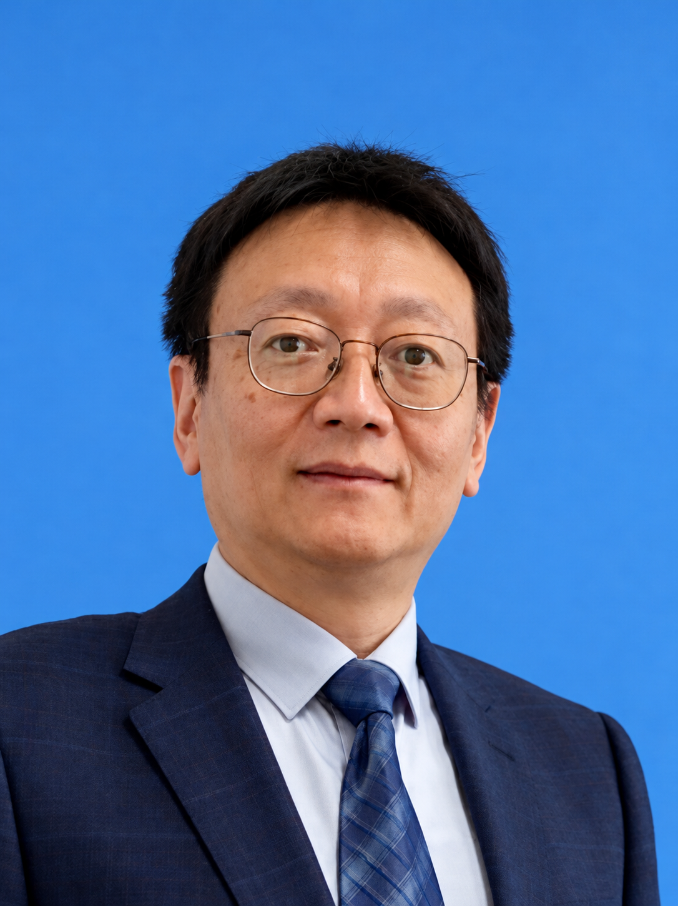
 
<strong>马晓星</strong>
 
<strong>成员</strong>
</td>
<td valign="top">
南京大学计算机学院教授、院长。长期从事面向开放动态环境的软件技术研究，近年来研究兴趣集中于神经符号融合的智能化软件技术方面。曾获国家杰出青年科学基金、国家973/863课题等重要项目资助；在国内外重要学术会议/期刊发表论文百余篇，两次获得国家科技进步二等奖（排名第2、第4）；曾入选教育部新世纪人才支持计划，获中创软件人才奖等。现任中国计算机学会软件工程专业委员会主任。
</td>
</tr>
</table>

<table>
<tr>
<td width="170" align="center" valign="top">
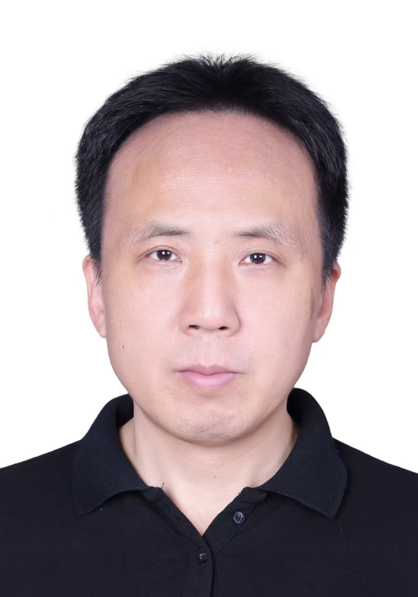
 
<strong>孙刚</strong>
 
<strong>成员</strong>
</td>
<td valign="top">
具备国有大行基础软硬件技术路线与技术架构深厚理论功底，长期深耕金融底层基础设施创新落地，牵头参与多项国家级课题，作为主要完成人多次获得人民银行金融科技发展奖，在金融核心系统软硬件选型和技术演进等方面具备丰富实践经验。
</td>
</tr>
</table>

<table>
<tr>
<td width="170" align="center" valign="top">
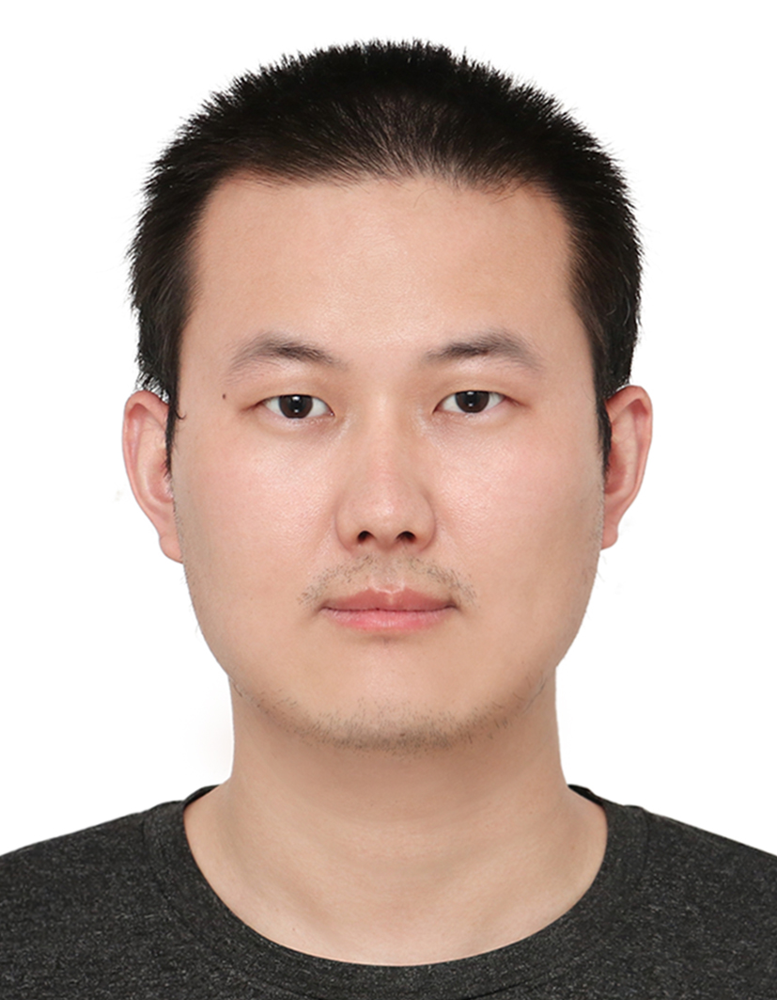
 
<strong>郑家欢</strong>
 
<strong>成员</strong>
</td>
<td valign="top">
2018年复旦大学计算机专业博士毕业后加入华为终端BG编译器部。历任编译器开发、编译器PL、俄研编译器LR、编译器XM，深度参与了编译器领域全模块设计与实现。现任终端BG编译器部主管，负责终端BG语言编译器与运行时业务竞争力构建与交付。
</td>
</tr>
</table>

<table>
<tr>
<td width="170" align="center" valign="top">
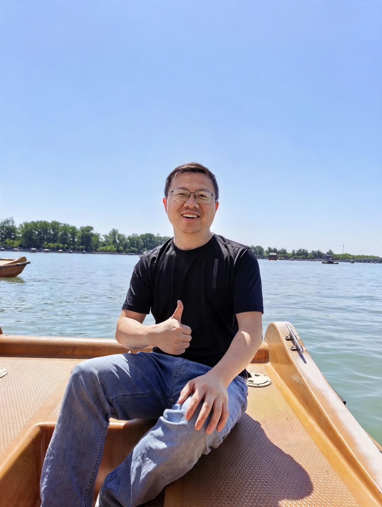
 
<strong>赵辛贵</strong>
 
<strong>成员</strong>
</td>
<td valign="top">
携程研发总监，负责移动端与大前端研发基础设施，涵盖移动端基础框架、集成发布、监控告警、性能与 UI 自动化测试等支撑体系，带领团队支撑各业务线研发效率与稳定性。近年推动团队向 AI Native 转型，主导研发系统与框架向 AI 友好方向演进，并负责公司内部办公 Agent 产品的研发。作为仓颉社区 core team 成员，推进仓颉语言在携程集团的落地与场景试点。
</td>
</tr>
</table>

# 关于执行总监

<table>
<tr>
<td width="170" align="center" valign="top">

 
<strong>胡晓明</strong>
 
<strong>执行总监</strong>
</td>
<td valign="top">
主要从事编程语言 DFX 特性、安全特性、工具链相关研究，曾任阿里巴巴安全专家。擅长编程语言技术、拥有十余年网络安全经验，包括漏洞挖掘与治理、车联网及移动安全，负责仓颉语言开源与社区建设，具备丰富的技术研究、团队管理及跨业务协同经验。
</td>
</tr>
</table>

