# 关于 TSC 成员

<table>
<tr>
<td width="170" align="center" valign="top">
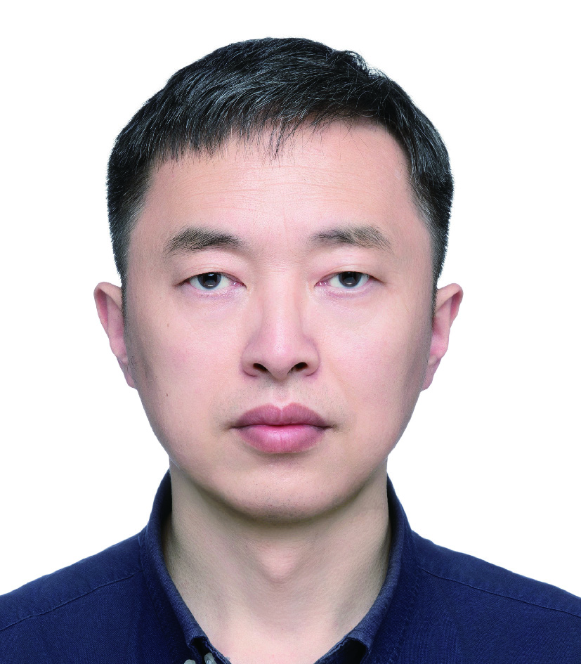
 
<strong>冯新宇</strong>
 
<strong>仓颉项目群TSC主席</strong>
</td>
<td valign="top">
华为编程语言首席专家，仓颉编程语言首席架构师，南京大学教授；主要研究方向为程序设计语言理论和形式化程序验证。主要工作包括仓颉编程语言、安全系统编程语言、操作系统内核验证、编译器验证、以及细粒度并发算法验证等。
</td>
</tr>
</table>

<table>
<tr>
<td width="170" align="center" valign="top">
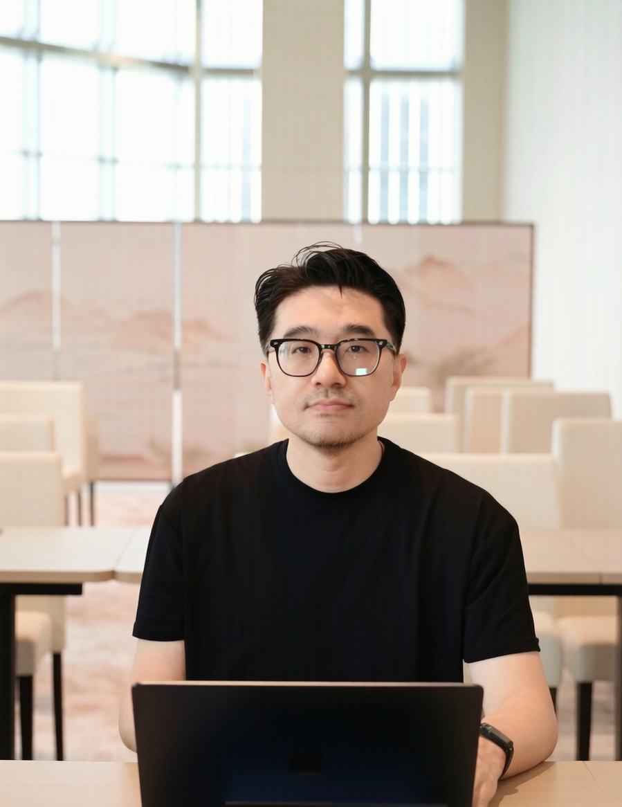
 
<strong>董鑫</strong>
 
<strong>仓颉项目群TSC副主席</strong>
</td>
<td valign="top">
2008-2017就职于微软海外欧洲研发中心，任技术专家，参与Microsoft Azure、Dynamics 365基础设施架构与技术管理工作。2017年回国加入华为， 先后从事华为云平台、昇腾AI芯片软件栈研发工作，担任高级技术专家，首席规划等角色。2022年起负责20212基础软件院编程语言与IDE业务项目群管理工作，与团队一起先后完成仓颉语言的发布、开源、开放及生态拓展等工作，并于2025年初开始推动团队AI先驱研发变革，取得卓越成效。
</td>
</tr>
</table>

<table>
<tr>
<td width="170" align="center" valign="top">
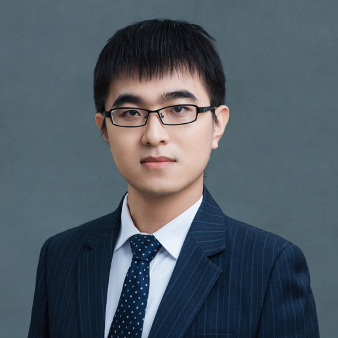
 
<strong>陈俊洁</strong>
 
<strong>仓颉项目群TSC成员</strong>
</td>
<td valign="top">
天津大学教授、博导、软件学院副院长，软件工程团队(TJU-WISE Lab)负责人，主持国家优青、重点研发计划青年科学家等项目；博士毕业于北京大学；研究方向主要为基础软件质量保障、代码智能体等；入选中国科协青年人才托举工程、斯坦福大学发布的全球前2%顶尖科学家榜单，荣获CCF优博、电子学会自然科学一等奖、十项最佳/杰出论文奖等奖项；成果在华为、字节等多家知名企业落地；担任CCF系统软件专委常委，AUSE、FCS、JCST、JSEP等期刊编委/青年编委，ICSE、FSE、ASE、ISSTA等顶会PC。
</td>
</tr>
</table>

<table>
<tr>
<td width="170" align="center" valign="top">
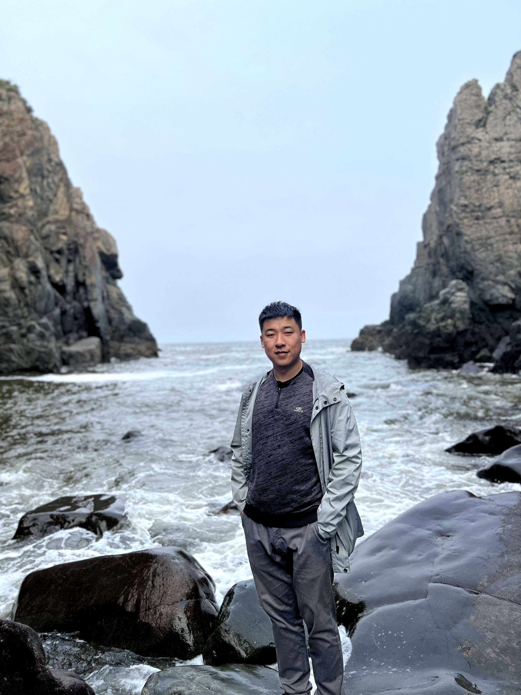
 
<strong>邓成瑞</strong>
 
<strong>仓颉项目群TSC成员</strong>
</td>
<td valign="top">
华为 IDE 技术专家，曾就职于 Intel 与阿里巴巴，长期从事开发工具与系统优化，作为核心成员参与 Eclipse TPTP、Intel TEE Runtime 等项目，拥有多项技术专利。
在华为 2012实验室，带领 IDE Lab 技术团队持续打造 BitFun Platform（毕方平台），为鸿蒙应用开发提供了多种开发工具技术，其中自研的 BitFun IDE 底座，成为鸿蒙电脑 DevEco Studio (Powered by BitFun) 的底层平台，使得在鸿蒙电脑上可以高效开发鸿蒙应用。在 AI 时代，BitFun 作为鸿蒙 DevEco 系列开发工具的底层平台，持续为 DevEco Code、DevEco CLI 等 AI Coding 产品提供先进的开发技术能力。
</td>
</tr>
</table>

<table>
<tr>
<td width="170" align="center" valign="top">
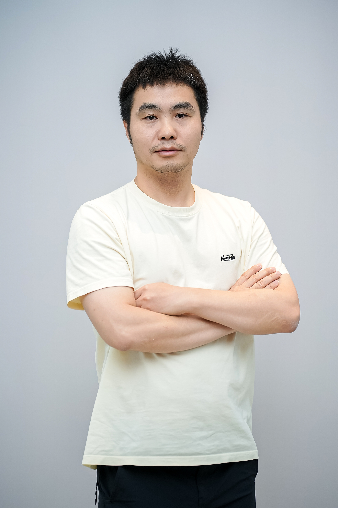
 
<strong>黎三平</strong>
 
<strong>仓颉项目群TSC成员</strong>
</td>
<td valign="top">
京东端基础技术部负责人，专注超级App架构演进，推动智能化与AI Native转型，致力于以技术创新提升用户体验和研发效率。
</td>
</tr>
</table>

<table>
<tr>
<td width="170" align="center" valign="top">
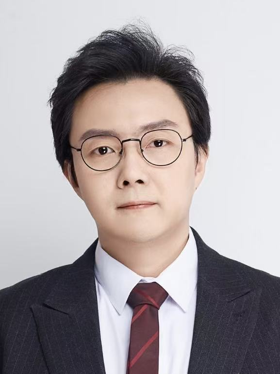
 
<strong>罗涛</strong>
 
<strong>仓颉项目群TSC成员</strong>
</td>
<td valign="top">
工商银行软件开发中心互联网金融研究团队负责人，负责移动端技术、空间信息技术、虚拟现实技术的研究与平台建设。主持建设了工行移动开发平台，为个人手机银行等移动应用提供核心引擎，在用户体验、应用研发、技术架构、生态拓展等方面提供技术支撑。建设智能仿真平台，通过元宇宙、数字人等虚拟现实技术革新交互体验。建设卫星遥感平台，将卫星、无人机等空间信息技术在银行广泛应用。以新技术赋能互联网金融业务快速发展。
</td>
</tr>
</table>

<table>
<tr>
<td width="170" align="center" valign="top">
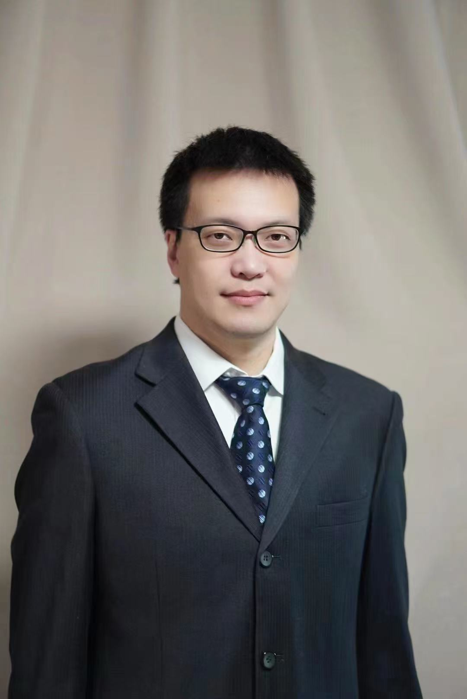
 
<strong>宋海峰</strong>
 
<strong>仓颉项目群TSC成员</strong>
</td>
<td valign="top">
华为语言虚拟机实验室专家，负责跨平台应用框架开发，包括 UI 渲染引擎，逻辑跨平台，跨语言交互，跨平台系统库，AI 辅助开发等方面，支持应用厂商通过跨平台开发提高开发效率，同步上线鸿蒙。
</td>
</tr>
</table>

<table>
<tr>
<td width="170" align="center" valign="top">
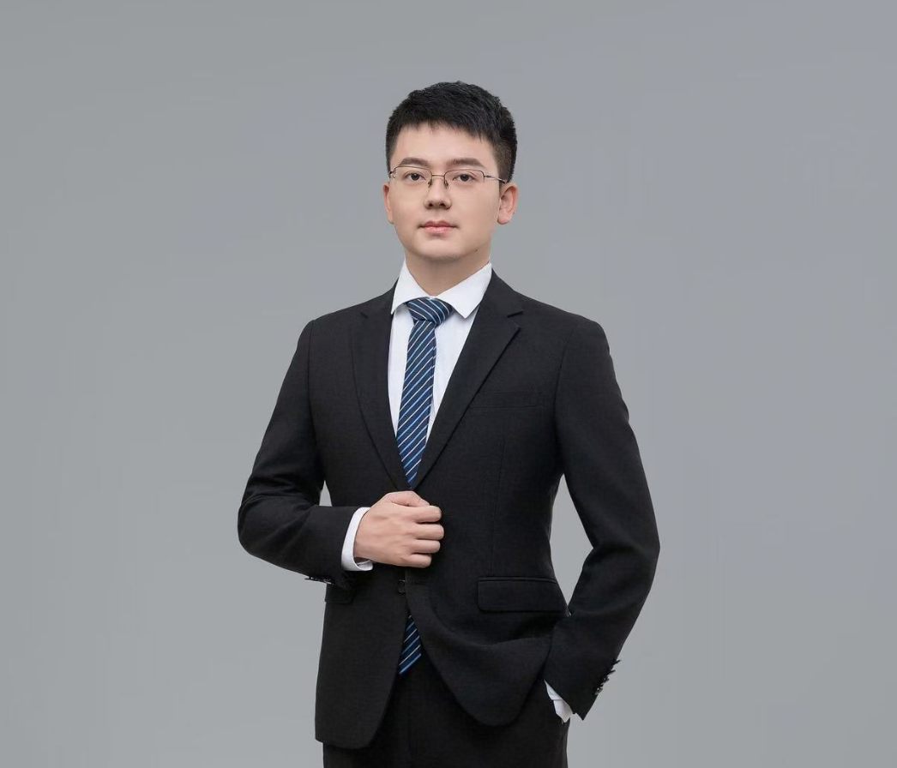
 
<strong>涂玏</strong>
 
<strong>仓颉项目群TSC成员</strong>
</td>
<td valign="top">
华为编程语言实验室主任。先后参与AI领域算子编程语言和仓颉编程语言项目。目前主要负责仓颉语言的编译前端实现，主要涉及的技术方向包括：多层级IR、程序分析、编译优化、元编程等。
</td>
</tr>
</table>

<table>
<tr>
<td width="170" align="center" valign="top">
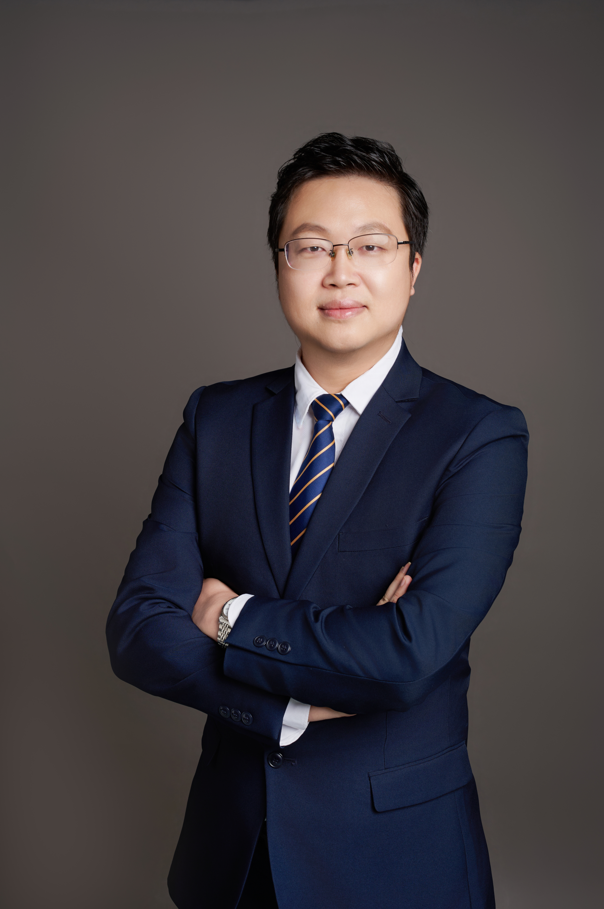
 
<strong>王尧波</strong>
 
<strong>仓颉项目群TSC成员</strong>
</td>
<td valign="top">
携程无线产品研发总监，负责移动框架、公共基础产品与AI智能体产品研发，统筹框架设计、技术落地与跨业务协同，支撑移动端智能化建设。
</td>
</tr>
</table>

<table>
<tr>
<td width="170" align="center" valign="top">
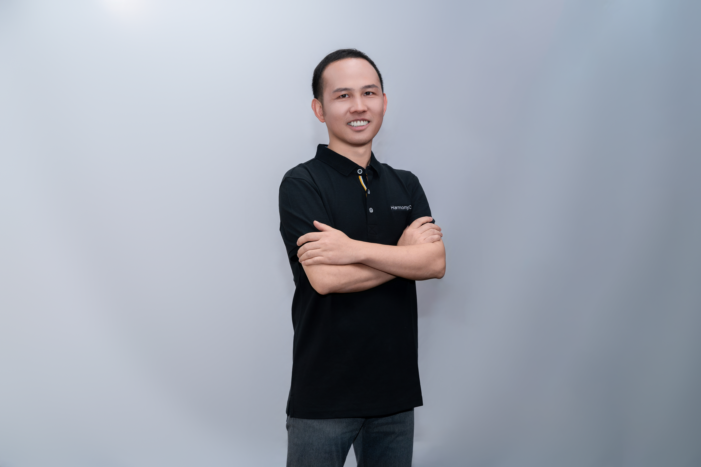
 
<strong>鲜余强</strong>
 
<strong>仓颉项目群TSC成员</strong>
</td>
<td valign="top">
现任华为终端编译器与编程语言首席架构师兼 TMG 主任，在 OpenHarmony 社区担任 PMC 委员及 Compiler & Runtime SIG 组长；同时在国外开源社区中，他曾以 WebKit Committer 身份贡献 JavaScriptCore JIT 编译器性能优化，以 Chromium Contributor 身份参与 Canvas 渲染优化及 V8 引擎优化工作。
</td>
</tr>
</table>

<table>
<tr>
<td width="170" align="center" valign="top">
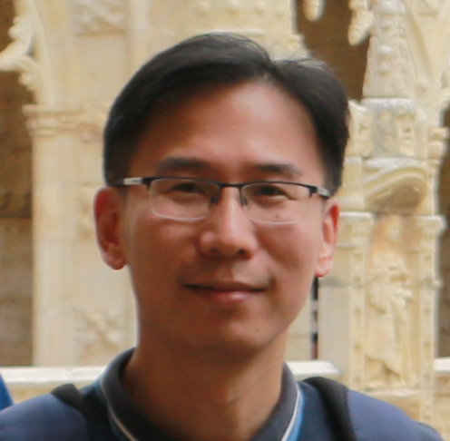
 
<strong>许畅</strong>
 
<strong>仓颉项目群TSC成员</strong>
</td>
<td valign="top">
南京大学计算机软件新技术全国重点实验室和计算机学院教授、博士生导师、国家级人才计划入选者、ACM杰出会员。主持和参与了多项国家和省部级的科研项目。研究兴趣包括大数据软件工程、智能软件测试与分析、以及自适应与自控软件系统。发表190余篇学术论文，工作被包括ACM Transactions on Software Engineering and Methodology (TOSEM)、IEEE Transactions on Software Engineering (TSE)、ESEC/FSE、ICSE和ASE等在内的国际顶级期刊与会议（CCF-A类）所收录，获得了多次ACM SIGSOFT杰出论文奖、最佳论文奖、及最佳论文提名奖。
</td>
</tr>
</table>

<table>
<tr>
<td width="170" align="center" valign="top">
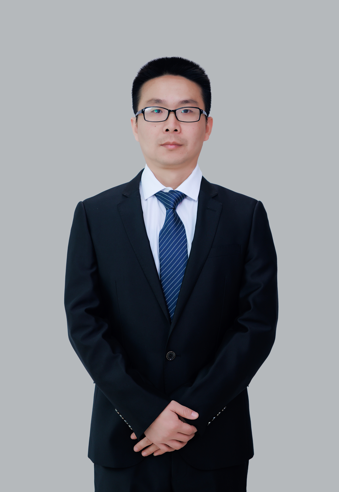
 
<strong>俞超</strong>
 
<strong>仓颉项目群TSC成员</strong>
</td>
<td valign="top">
2011年浙江大学毕业后加入华为编译器实验室，长期从事cpu/mcu/dsp/mcu编译器开发和性能优化工作，近5年主要聚焦于鸿蒙侧c/c++性能优化。
</td>
</tr>
</table>

<table>
<tr>
<td width="170" align="center" valign="top">
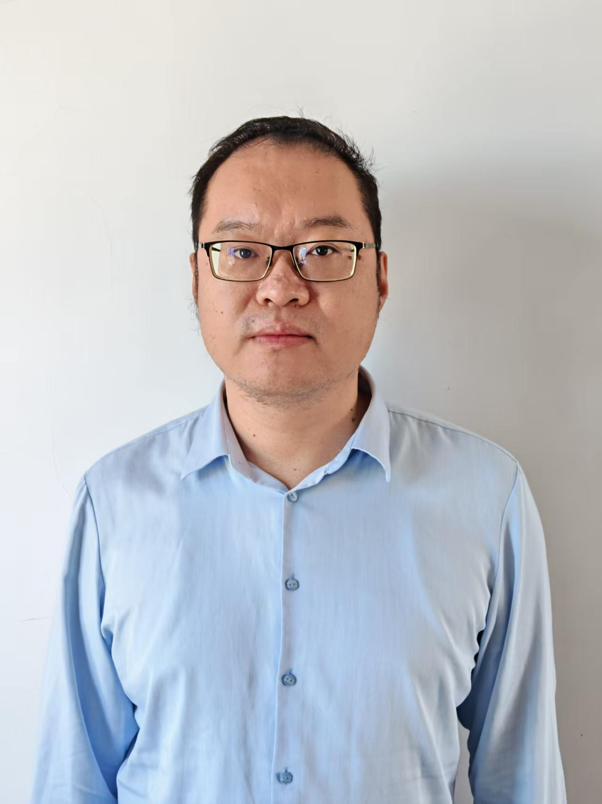
 
<strong>张毅然</strong>
 
<strong>仓颉项目群TSC成员</strong>
</td>
<td valign="top">
美团履约终端负责人，负责美团众包和美团骑手App研发工作。
</td>
</tr>
</table>

 

